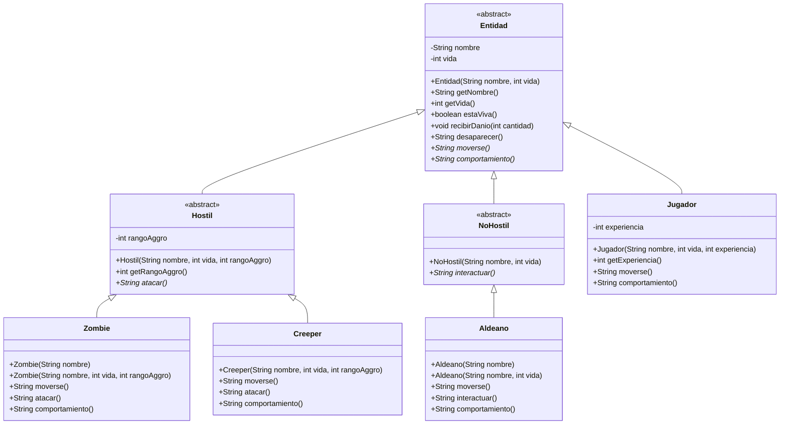

# EP-taller-git-2026

Taller de Git, Programación Orientada a Objetos y API REST.

**Alumno:** Elías Pont  
**Materia:** Lenguaje de Programación 3  
**Dominio:** Minecraft  
**Repositorio:** https://github.com/eliasleonardo11-dotcom/EP-taller-git-2026

## Tecnologías

- Java 21
- Spring Boot
- Maven
- Spring Web

## Licencia

Este proyecto utiliza la **Apache License 2.0**. El texto completo se encuentra en el archivo `LICENSE`.

## Organización del proyecto

```text
src/main/java/py/edu/uc/lp3/
├── EpTallerGit2026Application.java
├── domain/
│   └── minecraft/
│       ├── Entidad.java
│       ├── Hostil.java
│       ├── NoHostil.java
│       ├── Jugador.java
│       ├── Zombie.java
│       ├── Creeper.java
│       └── Aldeano.java
└── rest/
    └── controller/
        ├── IndexController.java
        └── EntidadController.java
```

## Ejecución

Desde la raíz del repositorio:

```bash
./mvnw spring-boot:run
```

La aplicación queda disponible en:

```text
http://localhost:8080
```

## Modelo de clases



## Sobrecarga y sobreescritura

### Sobrecarga

La **sobrecarga** ocurre cuando existen varios constructores o métodos con el mismo nombre, pero con distinta lista de parámetros. La elección de cuál utilizar se realiza en tiempo de compilación según los argumentos enviados.

En este proyecto se utiliza sobrecarga de constructores.

### Zombie

```java
public Zombie(String nombre) {
    this(nombre, 20, 10);
}

public Zombie(String nombre, int vida, int rangoAggro) {
    super(nombre, vida, rangoAggro);
}
```

El constructor simple delega al constructor completo mediante `this(...)`. El constructor completo utiliza `super(...)` para inicializar los datos heredados de `Hostil` y `Entidad`.

### Aldeano

```java
public Aldeano(String nombre) {
    this(nombre, 20);
}

public Aldeano(String nombre, int vida) {
    super(nombre, vida);
}
```

También en `Aldeano`, el constructor simple utiliza `this(...)` y el constructor completo delega la inicialización común mediante `super(...)`.

### Sobreescritura

La **sobreescritura** ocurre cuando una clase hija redefine un método heredado utilizando la misma firma. El método concreto que se ejecuta se decide en tiempo de ejecución según el tipo real del objeto.

La clase abstracta `Entidad` define:

```java
public abstract String moverse();
public abstract String comportamiento();
```

Estos métodos son sobrescritos con `@Override` por las cuatro clases concretas:

- `Zombie`
- `Creeper`
- `Aldeano`
- `Jugador`

Además:

- `Hostil` define el método abstracto `atacar()`, sobrescrito por `Zombie` y `Creeper`.
- `NoHostil` define el método abstracto `interactuar()`, sobrescrito por `Aldeano`.

### Diferencia entre sobrecarga y sobreescritura

| Concepto | Sobrecarga | Sobreescritura |
|---|---|---|
| Nombre | Igual | Igual |
| Parámetros | Diferentes | Misma firma |
| Resolución | Tiempo de compilación | Tiempo de ejecución |
| Ejemplo | Constructores de `Zombie` y `Aldeano` | `moverse()`, `comportamiento()`, `atacar()`, `interactuar()` |

## Herencia y polimorfismo

El controller trabaja con el tipo padre `Entidad`.

```java
Entidad entidad = new Zombie(nombre, vida, rangoAggro);
```

```java
Entidad entidad = new Aldeano(nombre, vida);
```

Ambos objetos se procesan mediante `respuesta(Entidad entidad)`, y el comportamiento concreto se resuelve mediante polimorfismo.

## Ocultamiento e invariantes

Los atributos del dominio son privados y no se exponen mediante setters públicos.

- El nombre no puede ser nulo ni vacío.
- La vida no puede ser negativa.
- El daño debe ser positivo.
- La vida nunca baja de cero.
- El rango de agresión no puede ser negativo.
- La experiencia del jugador no puede ser negativa.

## API REST

### GET /

```text
GET http://localhost:8080/
```

### Zombie completo

```text
GET http://localhost:8080/api/entidades/zombie?nombre=Zombie1&vida=20&rangoAggro=10
```

### Aldeano completo

```text
GET http://localhost:8080/api/entidades/aldeano?nombre=Aldeano1&vida=20
```

### Zombie con constructor simple

```text
GET http://localhost:8080/api/entidades/zombie/simple?nombre=ZombieSimple
```

### Aldeano con constructor simple

```text
GET http://localhost:8080/api/entidades/aldeano/simple?nombre=AldeanoSimple
```

Los endpoints devuelven JSON con tipo, nombre, vida, estado, movimiento y comportamiento.

## Conceptos de POO aplicados

- abstracción;
- encapsulamiento;
- herencia;
- sobrescritura;
- sobrecarga;
- polimorfismo;
- validación de invariantes.

## Bitácora de IA

El uso del asistente de IA se encuentra documentado en `BITACORA.md`, incluyendo el asistente, el modelo exacto y un resumen de los prompts.
