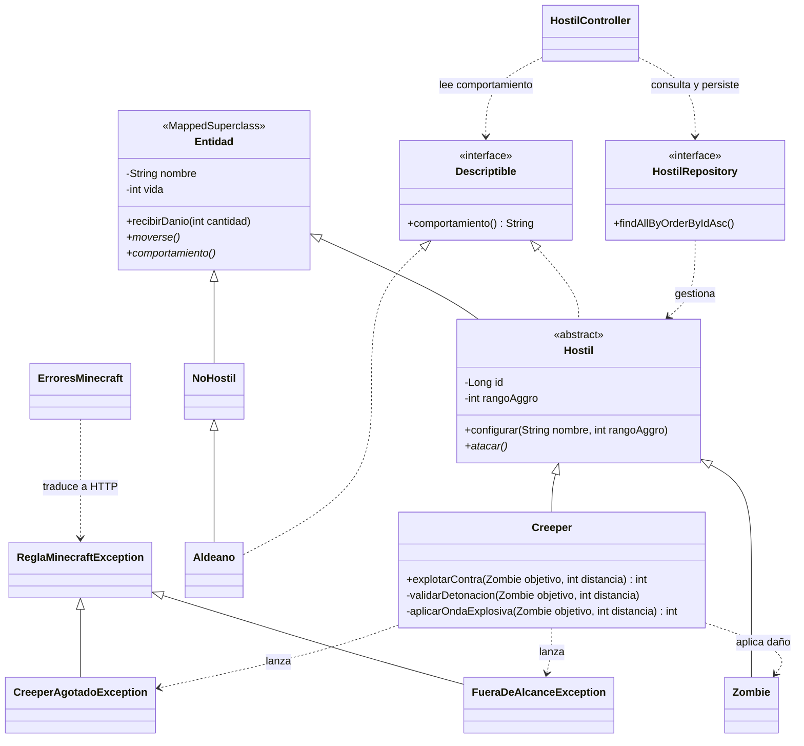

# EP-taller-git-2026 · POO-08

Elías Pont · Lenguaje de Programación 3 · Minecraft

API REST para guardar hostiles y simular una explosión entre un Creeper y un Zombie. El proyecto usa Java 21, Spring Boot, Spring Data JPA y H2. La licencia del proyecto es [Apache 2.0](LICENSE).

[Commit de la solución](https://github.com/eliasleonardo11-dotcom/EP-taller-git-2026/commit/1803a8eb06c81741776e6c4c6fe37752b895fe08)

## Arranque

Desde la raíz del repositorio, con JDK 21 disponible:

```bash
./mvnw spring-boot:run
```

En PowerShell, ejecutá `.\mvnw.cmd spring-boot:run`. Abrí [el inicio de la API](http://localhost:8080/) para comprobar el arranque. Para ejecutar las pruebas, usá `./mvnw test` (o `.\mvnw.cmd test` en PowerShell). Usan una base H2 en memoria para verificar el CRUD, las excepciones, las restricciones SQL y los casos límite de la explosión.

### Configuración y consola de H2

| Propiedad | Valor | Efecto |
| --- | --- | --- |
| `spring.datasource.url` | `jdbc:h2:file:./data/minecraft` | Guarda las filas en `data/minecraft.mv.db`, relativo al directorio de arranque. Conserva los datos al reiniciar. |
| `spring.datasource.username` | `sa` | Usuario local de H2. |
| `spring.datasource.password` | Vacío | La conexión de desarrollo usa una contraseña vacía. |
| `spring.jpa.hibernate.ddl-auto` | `update` | Hibernate crea o actualiza el esquema al arrancar y conserva las filas existentes. |
| `spring.jpa.open-in-view` | `false` | La persistencia se completa en la operación transaccional y las respuestas se construyen como datos de transporte. |
| `spring.profiles.default` | `dev` | Activa el perfil de desarrollo cuando no se selecciona otro. |
| `spring.h2.console.enabled` | `true` en `dev` | Habilita la consola web en desarrollo. |
| `spring.h2.console.path` | `/h2-console` en `dev` | Fija la ruta de acceso a la consola. |

En [la consola H2](http://localhost:8080/h2-console), ingresá la URL JDBC de la tabla anterior, el usuario `sa` y la contraseña vacía. Después de simular y antes de borrar, ejecutá:

```sql
SELECT id, tipo, nombre, vida, rango_aggro FROM hostiles ORDER BY id;
```

## Reglas de la explosión

1. Un `Creeper` vivo puede detonar contra un `Zombie` vivo si la distancia en bloques está entre cero y su `rangoAggro`, inclusive, y queda con cero de vida al detonar.
2. El `Zombie` recibe hasta 12 puntos de daño, con una reducción de 3 por bloque y una potencia mínima de 1 dentro del alcance, limitada por su vida restante.

La simulación aplica ambas reglas en una transacción sobre la familia `Hostil`. El resultado que queda en H2 es la nueva vida de los dos hostiles. El control de versión de JPA permite detectar modificaciones simultáneas y revertir la operación si hay un conflicto.

## Modelo y responsabilidades



`Hostil` hereda los datos comunes de `Entidad`. El protocolo `Descriptible` conecta a la familia hostil con `Aldeano`, de la familia `NoHostil`. `HostilController` depende de la interfaz del repositorio, cuya implementación genera Spring Data. El dominio conserva las reglas y `ErroresMinecraft` traduce cada tipo de excepción a HTTP.

**Sobrecarga.** `Zombie(String)` y `Creeper(String)` delegan en el constructor de tres argumentos mediante `this(...)`. Los valores por defecto son 20 de vida para ambos y un rango de 10 para el Zombie y de 3 para el Creeper. `Aldeano` mantiene sus dos constructores. Los constructores completos delegan al padre con `super(...)`.

**Sobreescritura.** `Creeper` y `Zombie` conservan `@Override` en `moverse()`, `atacar()` y `comportamiento()`. La firma se conserva y la ejecución elige el método de la clase concreta. En la sobrecarga, los argumentos determinan la firma.

## Qué hay que pensar

| Tema | Decisión del proyecto |
| --- | --- |
| Recurso y verbo | `/api/hostiles` representa la colección y `/api/hostiles/{id}` cada hostil. El verbo indica si se crea, se consulta, se actualiza o se elimina. |
| Identidad | H2 asigna el `id` numérico al insertar. El JSON de alta lo omite y el cliente lo obtiene en el cuerpo y en `Location` después de un `POST`. |
| Herencia y tablas | Usé `SINGLE_TABLE` porque `Creeper` y `Zombie` comparten todos sus datos persistidos. Una tabla permite listar ambos sin uniones. El discriminador `tipo` identifica cada fila y Jackson convierte el campo JSON `tipo` en un enum para seleccionar el constructor de dominio. |
| Interfaz y repositorio | `HostilController` usa el contrato de `HostilRepository` para pedir búsquedas y guardados. `Descriptible` aplica la misma idea al comportamiento del juego. |
| Protocolo del dominio | `GET /api/hostiles/{id}/comportamiento` usa la referencia `Descriptible`. Elegí el nombre `Descriptible` porque `comportamiento()` describe lo que hace cada criatura y se puede enviar también a un `Aldeano` mediante el mismo tipo. |
| Ocultamiento | Constructores y métodos del dominio validan nombre, vida, rango y daño. JPA carga los campos privados mediante constructores protegidos sin argumentos. H2 también exige valores obligatorios y verifica que la vida y el rango sean no negativos. Compará los listados 04 y 09 de Insomnia para comprobar que el alta ilegal deja las filas intactas. |
| PUT y PATCH | Elegí `PATCH` para actualizar `nombre`, `rangoAggro` o ambos. Un campo omitido o `null` conserva el valor anterior. Al menos uno debe tener valor. La vida se fija en el alta y la cambia el dominio durante la partida. |
| DELETE | El controlador le pide al repositorio que elimine la fila de la partida y responde 204. En el juego, la detonación deja al Creeper con vida cero y se puede seguir consultando hasta borrarlo. |
| Dos reglas | `POST /api/hostiles/{id}/explosiones` representa la detonación de un Creeper contra un Zombie. Un `GET` posterior de los hostiles muestra las dos vidas guardadas. |
| Excepciones | `ReglaMinecraftException` cubre invariantes generales. `FueraDeAlcanceException` identifica la distancia excesiva y `CreeperAgotadoException` identifica la falta de vida del Creeper. Cada tipo tiene su `@ExceptionHandler`. Una excepción comprobada obliga al llamador a capturarla o declararla. Elegí excepciones no comprobadas para que se propaguen hasta el handler HTTP y Spring revierta la transacción si la regla falla. Un ID inexistente es un error de búsqueda 404. El cuerpo incluye `codigo` y `mensaje`. |

Si se cambia H2 por otra base relacional, los primeros ajustes van en el driver de `pom.xml` y en las propiedades de conexión y esquema. El repositorio conserva su contrato y el método de explosión conserva las reglas del juego.

## Prueba con Insomnia

Importá [la colección POO-08 · Minecraft](insomnia/POO-08-Minecraft.json) desde **Import → File**. En el entorno base, `base_url` apunta a `http://localhost:8080`. [Referencia de importación de Insomnia](https://developer.konghq.com/insomnia/import-export/).

1. Ejecutá 01–03. Las altas guardan sus IDs en `creeper_id` y `zombie_id` automáticamente. Si tu instalación no ejecuta los scripts de respuesta, copiá cada ID al entorno base antes de continuar.
2. Ejecutá 04–07 para listar, consultar y renombrar al Zombie. Verificá que la segunda lectura conserve el nombre nuevo.
3. Ejecutá 08–11. Compará los IDs de 04 y 09, comprobá el 404 del ID 0 y leé el comportamiento del Zombie.
4. Ejecutá 12–15 en ese orden. Primero esperá 422 con `FUERA_DE_ALCANCE`. La explosión a distancia 1 causa 9 puntos de daño y deja las vidas en 0 y 11. Confirmalas con el listado 14 y, si querés ver las filas, con la consola H2. El segundo intento válido en distancia devuelve 409 con `CREEPER_AGOTADO`.
5. Ejecutá 16–18 para borrar los datos de ejemplo y confirmar con 404 que el Zombie ya no existe. El pedido 19 envía un subtipo desconocido y devuelve 400 con `PEDIDO_INVALIDO`.

Las [especificaciones para la entrega](docs/POO-08-Minecraft.md) enumeran los cuerpos y códigos HTTP. La [bitácora](BITACORA.md) registra el uso de IA.
