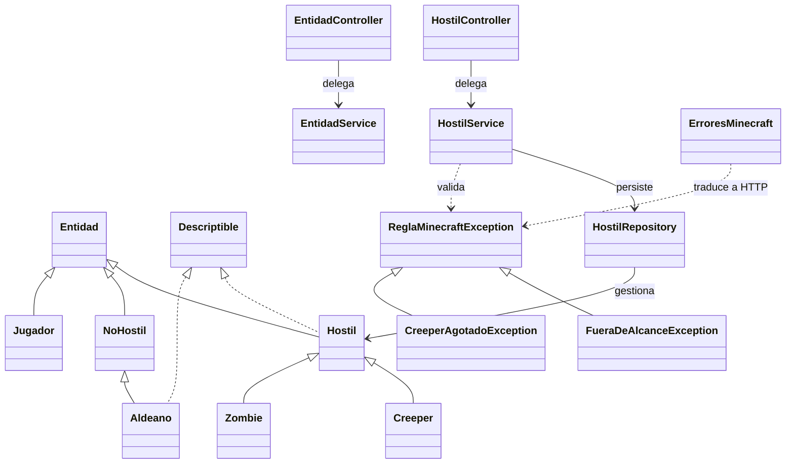

# EP-taller-git-2026 · POO-08

Elías Pont · Lenguaje de Programación 3 · Minecraft

API REST para guardar hostiles y simular una explosión entre un Creeper y un Zombie. El proyecto usa Java 21, Spring Boot, Spring Data JPA y H2. La licencia del proyecto es [Apache 2.0](LICENSE).

[Commit original de POO-08 (antes de esta corrección)](https://github.com/eliasleonardo11-dotcom/EP-taller-git-2026/commit/1803a8eb06c81741776e6c4c6fe37752b895fe08)

## Arranque

Desde la raíz del repositorio, con JDK 21 disponible:

```bash
./mvnw spring-boot:run
```

En PowerShell, ejecutá `.\mvnw.cmd spring-boot:run`. Abrí [el inicio de la API](http://localhost:8080/) para comprobar el arranque. Para ejecutar las pruebas, usá `./mvnw test` (o `.\mvnw.cmd test` en PowerShell). Usan una base H2 en memoria para verificar el CRUD, las excepciones, las restricciones SQL y los casos límite de la explosión.

### Configuración y consola de H2

| Propiedad | Valor | Efecto |
| --- | --- | --- |
| `spring.datasource.url` | `jdbc:h2:file:./data/minecraft` | Guarda las filas en `data/minecraft.mv.db`, relativo al directorio de arranque. Conserva los datos al reiniciar. |
| `spring.datasource.username` | `sa` | Usuario local de H2. |
| `spring.datasource.password` | Vacío | La conexión de desarrollo usa una contraseña vacía. |
| `spring.jpa.hibernate.ddl-auto` | `update` | Hibernate crea o actualiza el esquema al arrancar y conserva las filas existentes. |
| `spring.jpa.open-in-view` | `false` | La persistencia se completa en la operación transaccional y las respuestas se construyen como datos de transporte. |
| `spring.profiles.default` | `dev` | Activa el perfil de desarrollo cuando no se selecciona otro. |
| `spring.h2.console.enabled` | `true` en `dev` | Habilita la consola web en desarrollo. |
| `spring.h2.console.path` | `/h2-console` en `dev` | Fija la ruta de acceso a la consola. |

En [la consola H2](http://localhost:8080/h2-console), ingresá la URL JDBC de la tabla anterior, el usuario `sa` y la contraseña vacía. Después de simular y antes de borrar, ejecutá:

```sql
SELECT id, tipo, nombre, vida, rango_aggro FROM hostiles ORDER BY id;
```

## Reglas de la explosión

1. Un `Creeper` vivo puede detonar contra un `Zombie` vivo si la distancia en bloques está entre cero y su `rangoAggro`, inclusive, y queda con cero de vida al detonar.
2. El `Zombie` recibe hasta 12 puntos de daño, con una reducción de 3 por bloque y una potencia mínima de 1 dentro del alcance, limitada por su vida restante.

La simulación aplica ambas reglas en una transacción desde `HostilService` sobre la familia `Hostil`. El resultado que queda en H2 es la nueva vida de los dos hostiles. El control de versión de JPA permite detectar modificaciones simultáneas y revertir la operación si hay un conflicto.

## Corrección de POO-08

La corrección del commit original otorgó **18,5/24 (7,7/10)**. Esa nota es histórica; estas modificaciones cierran las observaciones para la revisión prevista en POO-09 y no afirman una nueva calificación.

| Observación del profesor | Cómo se corrigió |
| --- | --- |
| Falta la capa `service`; el controlador usa directamente el repositorio y maneja transacciones. | `HostilController` recibe `HostilService`. Solo el servicio usa `HostilRepository` y declara las transacciones de alta, actualización, borrado y explosión. El controlador recibe HTTP y construye la respuesta. |
| Las entidades lanzan excepciones y contienen las reglas. | Las validaciones y la explosión se trasladaron a `service/HostilService`; las excepciones están en `service/exception`. Las entidades conservan estado, mapeo JPA, constructores y mensajes descriptivos. Las rutas demostrativas de entidades validan mediante `EntidadService`. |
| Se puede crear un Zombie con vida 5000 o un Creeper muerto. | El servicio exige vida entre **1 y 20**, inclusive, para ambos tipos al crear y actualizar. H2 restringe el estado persistido a **0–20** porque una explosión sí puede producir una muerte. La vida no es editable por PATCH. Se rechaza actualizar un hostil muerto. |
| El título de la bitácora sigue en POO-06. | Se actualizó el título y se agregó el registro de esta corrección. |

La prueba `rechazaAltasConVidaImposibleSinCambiarH2` reproduce las altas ilegales para ambos tipos con vida -1, 0, 21 y 5000 y comprueba que H2 permanece vacío. Las otras pruebas verifican CRUD, persistencia de la explosión, errores, límites y reversión por concurrencia.

## Modelo y responsabilidades



`Hostil` hereda nombre y vida de `Entidad` y agrega identidad, versión y rango. `Creeper` y `Zombie` son subtipos independientes. `Descriptible` permite observar el comportamiento desde una interfaz y conecta la familia hostil con `Aldeano`.

**Sobrecarga.** `Zombie(String)` y `Creeper(String)` delegan con `this(...)` en el constructor completo: 20 de vida, rango 10 para Zombie y 3 para Creeper. Los constructores completos llaman a `super(...)`. Los constructores protegidos sin argumentos permiten cargar las entidades con JPA. La creación desde la API siempre pasa primero por la validación del servicio.

**Sobreescritura.** Los dos subtipos conservan `@Override` en `moverse()`, `atacar()` y `comportamiento()`. La clase concreta determina qué implementación se ejecuta; los argumentos distinguen las firmas de los constructores sobrecargados.

## Qué hay que pensar

| Tema | Decisión del proyecto |
| --- | --- |
| Recurso y verbo | `/api/hostiles` representa la colección y `/api/hostiles/{id}` cada hostil. El verbo indica si se crea, se consulta, se actualiza o se elimina. |
| Identidad | H2 asigna el `id` numérico al insertar. El JSON de alta lo omite y el cliente lo obtiene en el cuerpo y en `Location` después de un `POST`. |
| Herencia y tablas | Usé `SINGLE_TABLE` porque `Creeper` y `Zombie` comparten todos sus datos persistidos. Una tabla permite listar ambos sin uniones. El discriminador `tipo` identifica cada fila y Jackson convierte el campo JSON `tipo` en un enum para seleccionar el constructor de dominio. |
| Interfaz y repositorio | `HostilService` usa el contrato de `HostilRepository` para pedir búsquedas y guardados. `Descriptible` aplica la misma idea al comportamiento del juego. |
| Protocolo del dominio | `GET /api/hostiles/{id}/comportamiento` usa la referencia `Descriptible`. Elegí el nombre `Descriptible` porque `comportamiento()` describe lo que hace cada criatura y se puede enviar también a un `Aldeano` mediante el mismo tipo. |
| Ocultamiento | El servicio valida nombre, vida, rango y condiciones de la explosión antes de cambiar el estado. JPA carga los campos privados mediante constructores protegidos sin argumentos. H2 también exige valores obligatorios y verifica vida entre 0 y 20 y rango no negativo. Compará los listados 04 y 09 de Insomnia para comprobar que el alta ilegal deja las filas intactas. |
| PUT y PATCH | Elegí `PATCH` para actualizar `nombre`, `rangoAggro` o ambos. Un campo omitido o `null` conserva el valor anterior. Al menos uno debe tener valor. La vida se valida entre 1 y 20 en el alta y la cambia el servicio durante la partida. |
| DELETE | El controlador le pide al servicio, que usa el repositorio, que elimine la fila de la partida y responde 204. En el juego, la detonación deja al Creeper con vida cero y se puede seguir consultando hasta borrarlo. |
| Dos reglas | `POST /api/hostiles/{id}/explosiones` representa la detonación de un Creeper contra un Zombie. Un `GET` posterior de los hostiles muestra las dos vidas guardadas. |
| Excepciones | Las excepciones de `service/exception` se lanzan desde el servicio. `ReglaMinecraftException` cubre invariantes generales. `FueraDeAlcanceException` identifica la distancia excesiva y `CreeperAgotadoException` identifica la falta de vida del Creeper. Cada tipo tiene su `@ExceptionHandler`. Una excepción comprobada obliga al llamador a capturarla o declararla. Elegí excepciones no comprobadas para que se propaguen hasta el handler HTTP y Spring revierta la transacción si la regla falla. Un ID inexistente es un error de búsqueda 404. El cuerpo incluye `codigo` y `mensaje`. |

Si se cambia H2 por otra base relacional, los primeros ajustes van en el driver de `pom.xml` y en las propiedades de conexión y esquema. El repositorio conserva su contrato y el método de explosión conserva las reglas del juego.

## Prueba con Insomnia

Importá [la colección POO-08 · Minecraft](insomnia/POO-08-Minecraft.json) desde **Import → File**. En el entorno base, `base_url` apunta a `http://localhost:8080`. [Referencia de importación de Insomnia](https://developer.konghq.com/insomnia/import-export/).

1. Ejecutá 01–03. Las altas guardan sus IDs en `creeper_id` y `zombie_id` automáticamente. Si tu instalación no ejecuta los scripts de respuesta, copiá cada ID al entorno base antes de continuar.
2. Ejecutá 04–07 para listar, consultar y renombrar al Zombie. Verificá que la segunda lectura conserve el nombre nuevo.
3. Ejecutá 08–11. Compará los IDs de 04 y 09, comprobá el 404 del ID 0 y leé el comportamiento del Zombie.
4. Ejecutá 12–15 en ese orden. Primero esperá 422 con `FUERA_DE_ALCANCE`. La explosión a distancia 1 causa 9 puntos de daño y deja las vidas en 0 y 11. Confirmalas con el listado 14 y, si querés ver las filas, con la consola H2. El segundo intento válido en distancia devuelve 409 con `CREEPER_AGOTADO`.
5. Ejecutá 16–18 para borrar los datos de ejemplo y confirmar con 404 que el Zombie ya no existe. El pedido 19 envía un subtipo desconocido y devuelve 400 con `PEDIDO_INVALIDO`.

Las [especificaciones para la entrega](docs/POO-08-Minecraft.md) enumeran los cuerpos y códigos HTTP. La [bitácora](BITACORA.md) registra el uso de IA.

## Alcance del modelo y revisión manual

Se modelan Creepers y Zombies normales con vida máxima 20. El rango configurable y la fórmula `max(1, 12 - 3 × distancia)` son una **simplificación didáctica de la simulación**, no una reproducción exacta del motor de explosiones de Minecraft. El contrato del ejercicio se mantiene: a distancia 1 se aplican 9 puntos de daño y el Creeper se consume.

Para verificar la corrección en Insomnia, enviá altas con vida 0 y 5000 para ambos tipos: deben responder 400 con `REGLA_MINECRAFT`. Con vida 1 y 20 deben responder 201. Compará `GET /api/hostiles` antes y después de cada rechazo. Un PATCH con `vida` se rechaza como campo desconocido; un PATCH de configuración sobre un hostil muerto responde 400 y conserva su estado.

En una base de desarrollo anterior pueden existir filas ilegales creadas antes de esta corrección. Revisalas con `SELECT * FROM hostiles WHERE vida < 0 OR vida > 20;` y eliminá explícitamente esos datos de prueba por la API antes de reutilizarla. La aplicación no borra automáticamente la base existente. La restricción SQL actualizada se verifica con un esquema nuevo en las pruebas; `ddl-auto=update` no garantiza reemplazar restricciones antiguas.

Los pedidos 20–23 de Insomnia reproducen los estados imposibles señalados en la corrección. La configuración de pruebas carga Mockito al iniciar la JVM para evitar problemas de conexión del agente en Windows con JDK recientes.
